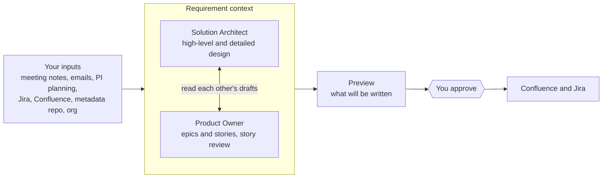

# sf-agent-po user guide

This guide takes you from installation to your first design and backlog, then covers day-to-day use. If you only have five minutes, do [Check that it works](#check-that-it-works). If you have half an hour, continue with [Your first test run](#your-first-test-run-the-insurance-sample).

- [How it works](#how-it-works)
- [Before you start](#before-you-start)
- [Install and connect the server](#install-and-connect-the-server)
- [Check that it works](#check-that-it-works)
- [Add the agents to your project](#add-the-agents-to-your-project)
- [Your first test run: the insurance sample](#your-first-test-run-the-insurance-sample)
- [Build a context from your own inputs](#build-a-context-from-your-own-inputs)
- [Working with the Solution Architect](#working-with-the-solution-architect)
- [Working with the Product Owner](#working-with-the-product-owner)
- [Publish to Confluence and Jira](#publish-to-confluence-and-jira)
- [Troubleshooting](#troubleshooting)
- [Reference](#reference)

## How it works

sf-agent-po is not an app you open. It is an MCP server that adds Salesforce Solution Architect and Product Owner skills to the AI assistant you already use: Claude Code, Cursor, or GitHub Copilot in VS Code. Your assistant's model does the thinking. The server keeps your inputs, saves the drafts, and publishes to Confluence and Jira.

Five ideas explain everything else in this guide:

- **Requirement context.** A named collection of inputs for one feature or epic, for example `renewal`. You add meeting notes, emails, PI planning, Jira issues, Confluence pages, a metadata repo and an org to it. Every tool takes the context name; if you name none, it uses `default`.
- **Solution Architect (SA).** Drafts a high-level design from raw inputs, or a detailed design for given stories, fitted to your existing metadata.
- **Product Owner (PO).** Turns the inputs and the SA's design into epics and user stories with Given/When/Then acceptance criteria, or reviews existing Jira stories for readiness.
- **Artifacts.** Designs and backlogs are saved back into the same context as versioned drafts. Whichever agent runs second reads the first one's work, so you can start with either.
- **Approval-gated publishing.** Nothing is written to Confluence or Jira until you have seen a preview and said yes.

Contexts are stored as JSON files in a workspace folder on your machine. Point all your tools at the same workspace and a context started in Claude Code is there in Cursor and Copilot too.



The two agents work inside one context and read each other's saved drafts; a preview and your approval stand between them and Confluence or Jira.

## Before you start

For a first test you only need Node.js, git and one of the three AI tools; everything else can wait until you work with real inputs.

| What | Needed for | Check it with |
| --- | --- | --- |
| Node.js 22 (20 also runs the server) | Running the server (required) | `node --version` |
| git | Getting and building the server (required) | `git --version` |
| Claude Code, Cursor, or VS Code with GitHub Copilot | Talking to the agents (one is required) | Copilot needs Agent mode in Chat |
| Atlassian API token | Reading and publishing Jira and Confluence | Create one at [id.atlassian.com](https://id.atlassian.com/manage-profile/security/api-tokens) |
| Salesforce CLI (`sf`) | Reading an org | `sf --version`, then `sf org login web --alias my-org` |
| GitHub CLI (`gh`) | Metadata repos on GitHub | `gh auth status` |
| GitLab CLI (`glab`) | Metadata repos on GitLab | `glab auth status` |
| Git Credential Manager | Metadata repos on Azure DevOps | Clone the repo once by hand to cache your login |

Input files must be text: Markdown, plain text, `.eml` emails, CSV, JSON or HTML. Word, PDF and Outlook `.msg` files are not read yet. Outlook on the Mac and the new Outlook can save an email as `.eml`; classic Outlook on Windows saves `.msg`, so paste those emails into the chat instead.

## Install and connect the server

You build the server once from the repository, then register it in each AI tool you use. Every tool must point at the same build and the same workspace folder.

### 1. Build it

```bash
git clone https://github.com/taouani/sf-agent-po.git
cd sf-agent-po
npm install
npm run build
pwd
```

The server is `dist/index.js` inside the folder `pwd` printed. On Node 20, `npm install` prints `EBADENGINE` warnings for the test tools; they are harmless for running the server. The configs below need its absolute path, for example `/Users/tarek/dev/sf-agent-po/dist/index.js`, or `C:/dev/sf-agent-po/dist/index.js` on Windows (forward slashes work in JSON). After each `git pull`, run `npm install` and `npm run build` again, then restart your tool.

### 2. Choose one workspace folder

Set `SF_AGENT_WORKSPACE` to an absolute folder, for example `/Users/tarek/sf-agent-workspace`. Without it, each tool creates a `.sf-agent` folder wherever it starts the server, and a context added in one tool seems to vanish in another. Write the full path: `~` is not expanded in these configs.

| Variable | Value | When |
| --- | --- | --- |
| `SF_AGENT_WORKSPACE` | Absolute path of your workspace folder | Always |
| `ATLASSIAN_SITE_URL` | `https://your-company.atlassian.net` | Jira or Confluence |
| `ATLASSIAN_EMAIL` | Your Atlassian login email | Jira or Confluence |
| `ATLASSIAN_API_TOKEN` | The token from the [Before you start](#before-you-start) table | Jira or Confluence |

You can leave the three Atlassian variables out for the first test and add them later.

### 3. Register it in your tool

**Claude Code.** Run this once in a terminal:

```bash
claude mcp add sf-agent-po --scope user \
  -e SF_AGENT_WORKSPACE=/Users/you/sf-agent-workspace \
  -e ATLASSIAN_SITE_URL=https://your-company.atlassian.net \
  -e ATLASSIAN_EMAIL=you@company.com \
  -e ATLASSIAN_API_TOKEN=your-token \
  -- node /absolute/path/to/sf-agent-po/dist/index.js
```

`--scope user` makes the server available in every project. Without it, it only exists in the folder where you ran the command, which is a common reason for "I installed it but it is not there". To change a setting later, run `claude mcp remove sf-agent-po --scope user` and add it again.

**Cursor.** Put this in `~/.cursor/mcp.json` for all projects, or in `.cursor/mcp.json` inside one project:

```json
{
  "mcpServers": {
    "sf-agent-po": {
      "command": "node",
      "args": ["/absolute/path/to/sf-agent-po/dist/index.js"],
      "env": {
        "SF_AGENT_WORKSPACE": "/Users/you/sf-agent-workspace",
        "ATLASSIAN_SITE_URL": "https://your-company.atlassian.net",
        "ATLASSIAN_EMAIL": "you@company.com",
        "ATLASSIAN_API_TOKEN": "your-token"
      }
    }
  }
}
```

**GitHub Copilot in VS Code.** Put this in `.vscode/mcp.json` in your project, or run **MCP: Open User Configuration** from the Command Palette for all projects. VS Code asks for the token the first time and stores it securely:

```json
{
  "inputs": [{ "id": "atlassian-token", "type": "promptString", "description": "Atlassian API token", "password": true }],
  "servers": {
    "sf-agent-po": {
      "type": "stdio",
      "command": "node",
      "args": ["/absolute/path/to/sf-agent-po/dist/index.js"],
      "env": {
        "SF_AGENT_WORKSPACE": "/Users/you/sf-agent-workspace",
        "ATLASSIAN_SITE_URL": "https://your-company.atlassian.net",
        "ATLASSIAN_EMAIL": "you@company.com",
        "ATLASSIAN_API_TOKEN": "${input:atlassian-token}"
      }
    }
  }
}
```

Claude Code and Cursor keep the token in plain text in their config. Use the user-level config rather than a project file, so the token never ends up in git.

## Check that it works

In five minutes you can confirm the tool sees the server and that the server can save a context. Do this before anything else; most "I'm lost" moments are a server that never connected.

**First, see that the server is connected:**

| Tool | Where to look | What you should see |
| --- | --- | --- |
| Claude Code | Type `/mcp` in a session, or run `claude mcp list` in a terminal | `sf-agent-po` marked connected |
| Cursor | Cursor Settings, then the MCP section | `sf-agent-po` with a green dot and its tools listed |
| VS Code Copilot | Command Palette, **MCP: List Servers** (start it if stopped). In Chat, switch to **Agent** mode and open the tools picker | `sf-agent-po` running, with its tools ticked |

The server has 20 tools and 4 prompts. If your tool shows fewer, or none, go to [Troubleshooting](#troubleshooting).

**Then type these three requests in the chat**, one at a time. Approve the tool call when your tool asks.

1. `Call the sf-agent-po context_list tool.`
    - Expect: "No contexts yet. Add a document to create one." (or the names of contexts you already made).
2. `Add this text to the context smoke-test as meeting notes, titled "Kickoff": "Agents want a list of policies renewing in the next 30 days." Then show the context.`
    - Expect: "Added 1 document(s) to context "smoke-test"", then a line like `[doc-…] meeting-notes: Kickoff`.
3. `Get the industry guidance for insurance.`
    - Expect: a block starting "Industry: Insurance" listing Financial Services Cloud with its insurance data model, OmniStudio and Experience Cloud.

If all three work, open your workspace folder: there is now a `contexts/smoke-test.json` file. That is where everything lives. Delete that file to throw the test context away.

## Add the agents to your project

The server alone gives you tools and four MCP prompts. To get named agents and short slash commands, generate the agent files into the project folder you work in (for example your Salesforce repo):

```bash
node /absolute/path/to/sf-agent-po/dist/index.js init --dir /path/to/your/project
```

Add `--host claude-code`, `--host cursor` or `--host copilot` to write only one tool's files (repeat it, or separate hosts with commas, for several), and `--dry-run` to see the list first. Existing files are skipped unless you add `--force`. Commit the files so your team gets the same agents. Start a new session in your tool afterwards so it loads them.

| Tool | Files written | Commands |
| --- | --- | --- |
| Claude Code | `.claude/agents/salesforce-solution-architect.md`, `salesforce-product-owner.md`, and `.claude/commands/` | `/sa-hld`, `/sa-detailed`, `/po-backlog`, `/po-review` |
| Cursor | `.cursor/rules/salesforce-*.mdc` and `.cursor/commands/` | The same four, in Agent chat |
| VS Code Copilot | `.github/agents/*.agent.md` and `.github/prompts/` | The same four, in Agent mode |

VS Code also reads the Claude Code agents in `.claude/agents`, so when those exist the Copilot agent files are skipped to avoid listing each agent twice. That is expected.

### Which to use when

| You want to | Claude Code | Cursor | VS Code Copilot |
| --- | --- | --- | --- |
| Draft a high-level design | `/sa-hld renewal` | `/sa-hld` then say "context renewal" | `/sa-hld context=renewal` |
| Draft a detailed design for stories | `/sa-detailed renewal S1 S2` | `/sa-detailed` then name the context and stories | `/sa-detailed context=renewal S1 S2` |
| Build a backlog | `/po-backlog renewal` | `/po-backlog` then name the context | `/po-backlog context=renewal` |
| Review Jira stories | `/po-review renewal PORT-12 PORT-13` | `/po-review` then name the context and keys | `/po-review context=renewal PORT-12` |
| Chat freely with an agent | Ask Claude to use the salesforce-product-owner agent | The rules are picked up from your request, or @-mention the rule | Pick Salesforce Product Owner in the agent picker (listed as salesforce-product-owner when the Claude Code files are there) |

In Claude Code, the first word after the command is the context name and the rest is the focus. Industry: add "use the insurance industry template" to any request.

Two tips for Claude Code:

- Prefer the slash commands over the subagents for anything you want to review or publish. A subagent works on its own and hands back a result; it cannot stop to ask for your approval in the middle.
- Without the agent files, the MCP prompts still work: `/mcp__sf-agent-po__sa_high_level_design` and so on, with the context and industry as arguments. In VS Code they appear as `/mcp.sf-agent-po.sa_high_level_design`.

## Your first test run: the insurance sample

The repository ships a realistic sample: an insurer's renewal portal with four inputs, a small metadata repo, and a rubric of what good output contains. It needs no Jira, Confluence or org, so it is the best first test. Allow about 30 minutes. The commands are Claude Code's; in Cursor and Copilot use the forms from [Which to use when](#which-to-use-when).

### Step 1. Load the inputs

Replace the path with where you cloned the repository:

> Add all files in /absolute/path/to/sf-agent-po/examples/insurance-renewal/inputs to the context insurance-renewal. Then add /absolute/path/to/sf-agent-po/examples/insurance-renewal/metadata as a local metadata repository. Then show the context.

You should see 5 documents:

- 2 emails: the business owner's "Re: Renewal portal scope" and InfoSec's "Security requirements for the renewal portal"
- the kickoff notes and the PI 2027.1 planning objectives
- a metadata inventory: `Policy__c` with `Account__c` and `Premium__c`, the `Policy_Renewal` flow and `PolicyTrigger` on the same object, `PolicyService`, the `policyCard` component and the `Policy_Admin` permission set

Each document gets an id such as `[doc-b24e7134f2]`. The agents cite these ids, so you can always trace a statement back to its source.

### Step 2. Draft the high-level design

> /sa-hld insurance-renewal Use the insurance industry template.

The Solution Architect reads all 5 documents, drafts a design in 16 sections, saves it as version 1 and summarises its decisions and open questions. It takes a few minutes. Check that the design:

- treats the policy administration system as the source of truth for quotes; Salesforce does not price
- covers all six InfoSec requirements: MFA, own data only, no card data in Salesforce (hosted payment page), encryption at rest, 7-year audit of logins and acceptances, a penetration test
- notices that 7 years of audit exceeds standard retention and proposes Field Audit Trail, Event Monitoring or an archive
- flags the risk of the existing flow and trigger both running on `Policy__c`
- records the conflict between the PI stretch objective and the business owner's email, and follows the email: mid-term changes are out of scope
- cites `[doc-…]` ids and lists open questions with an owner

The full checklist is in [`examples/insurance-renewal/rubric.md`](../examples/insurance-renewal/rubric.md).

### Step 3. Ask for a change

> Change the PAS integration to a nightly cached copy of renewal quotes, explain the trade-off, and save it as a new version.

The design is saved as version 2. Earlier versions are not kept as separate copies; the version number tells you how often it changed.

### Step 4. Build the backlog from the design

> /po-backlog insurance-renewal Use the insurance industry template.

The Product Owner reads the inputs and the design, drafts epics and stories, and saves them. Saving runs a quality check; the agent fixes every ERROR and saves again before it shows you the summary. Expect epics for online renewal, the agents' 30-day worklist, security, and the PAS integration, plus a spike on PAS performance at peak. Compare it with the hand-written answer in [`examples/insurance-renewal/reference-backlog.json`](../examples/insurance-renewal/reference-backlog.json).

### Step 5. Look at it from different angles

- `Show the backlog as a table: id, summary, priority, points, depends on.`
- `Which story covers each InfoSec requirement?`
- `Run the backlog quality check again.`
- `What did you assume, and what is still open?`

### Step 6. Go the other way: a detailed design for two stories

> /sa-detailed insurance-renewal S2 S3

The Solution Architect writes a build-ready design for those stories, fitted to the existing metadata, with each acceptance criterion mapped to components and tests. Use the story ids from your own backlog.

When you are done, keep the context to try publishing (see [Publish to Confluence and Jira](#publish-to-confluence-and-jira)), or delete `contexts/insurance-renewal.json` in your workspace. The second sample, [`examples/banking-onboarding`](../examples/banking-onboarding), has no metadata: use it to see how the agents behave when the current org is unknown.

## Build a context from your own inputs

Create one context per feature or epic, named with letters, digits, dots, dashes or underscores (for example `renewal-portal`). You add inputs by asking in plain language; the assistant picks the right tool. Adding the same file, folder, Jira issue or page again replaces the earlier copy, so re-add notes after you edit them. Pasted text is different: an edited paste is kept next to the old one, so remove the old one.

| Input | Ask for example | Good to know |
| --- | --- | --- |
| Meeting notes, PI planning, other documents | `Add the files in /Users/me/Shared/renewal-kickoff to the context renewal-portal as meeting notes.` | A folder is read with all its subfolders. Say the kind (meeting notes, PI planning) so the agents weigh it right. The kind applies to every file in the folder, so add emails on their own. |
| Emails | `Add /Users/me/Mail/security-reqs.eml to renewal-portal.` | `.eml` files keep sender, date and subject. Or paste: `Add this email from InfoSec to renewal-portal as an email: …` |
| Text from anywhere | `Add this to renewal-portal as meeting notes, titled "Steering call 28 Oct": …` | Works for Word or Teams content you copy and paste. |
| Jira issues | `Add Jira issues PORT-12 and PORT-15 to renewal-portal.` or `Add the Jira issues matching project = PORT AND fixVersion = "R1".` | By key or JQL, 50 issues by default and up to 200. Needs the Atlassian variables. |
| Confluence pages | `Add the Confluence page https://your-company.atlassian.net/wiki/spaces/ARCH/pages/123456/Renewal to renewal-portal.` | Full page URL or page id. Short `/x/` links do not work. |
| Metadata repo, local or shared folder | `Add /Users/me/repos/salesforce-core as a local metadata repository to renewal-portal.` | Must be in Salesforce DX source format (files such as `Policy__c.object-meta.xml`). The older Metadata API format is not analysed yet. |
| Metadata repo on GitHub, GitLab or Azure DevOps | `Add the GitHub metadata repo acme/salesforce-core, branch develop, to renewal-portal.` | Cloned with your own `gh`, `glab` or git login into the workspace's `repos` folder. For Azure DevOps, give the clone URL. |
| Salesforce org | `Add the org my-org to renewal-portal, with details for Account, Opportunity and Policy__c.` | Read-only, through `sf`. Lists custom objects and, for the objects you name, their record types, custom fields and lookups. |

To see what is in a context, ask `Show the context renewal-portal`. To drop something, ask `Remove document doc-… from renewal-portal`. `List my contexts` shows them all.

Metadata and the org are what stop the agents from guessing. Without them, the designs say the current state is unknown and list it as an open question instead of inventing components.

## Working with the Solution Architect

Use the high-level design at the start, from raw inputs; use the detailed design once stories exist and you need something the team can build.

| | High-level design | Detailed design |
| --- | --- | --- |
| Start it with | `/sa-hld <context> [focus]` | `/sa-detailed <context> <stories, epics or Jira keys>` |
| Reads | All inputs, metadata and org | The stories in scope, the high-level design, metadata and org |
| Produces | 16 sections: context and scope, personas and licences, current state, solution overview, data model, automation, user experience, integrations, reporting, security and compliance, non-functional requirements, impact on the existing org, delivery approach, decisions, risks and open questions, traceability | 9 sections: scope, data model changes, automation, user interface, integrations, security, test approach, deployment, open questions and risks |
| Saved as | A design of type high-level | A design of type detailed |

**How to get a good result**

- Give it a focus when the scope is large: `/sa-hld renewal-portal integrations and security`.
- Name the industry: `Use the financial-services industry template.` The 11 templates are listed in the [Reference](#industry-templates); common names such as "banking" or "healthcare" work too.
- Add metadata or the org before asking. Every claim about the existing org must come from them, or the design says it does not know.
- Ask follow-ups in the same chat: `Why Flow and not Apex for the renewal reminder?`, `Add a section on data migration from the legacy portal`, `Make the integration asynchronous and save a new version.`
- Each save with the same title makes a new version of the same design. A new title makes a separate design.

The Product Owner reads any design in the context automatically, so after a high-level design the natural next step is `/po-backlog <context>`.

## Working with the Product Owner

The Product Owner has two jobs: build a new backlog (`/po-backlog`), or review stories that are already in Jira (`/po-review`).

### Build a backlog

`/po-backlog <context> [scope]` turns the inputs, and the SA's design when there is one, into epics and stories. Each story has a specific persona, "I want" and "so that", Given/When/Then acceptance criteria, non-functional notes, a MoSCoW priority, optional story points, dependencies, and the ids of the documents it comes from. Open questions that block estimation become spikes.

Every save runs a quality check, and the agent works through it before showing you the backlog:

| Level | What it means | Examples |
| --- | --- | --- |
| ERROR | Must be fixed; blocks publishing to Jira | Duplicate ids or Jira keys, a dependency on a story that does not exist, circular dependencies |
| WARNING | Should be fixed, or the agent explains why not | Persona just "user", points off the 1, 2, 3, 5, 8, 13 scale or over 8, "fast" or "user-friendly" in a criterion, a story with no source, a security input no story cites |
| INFO | Worth a look | An input nobody cites, open questions without a spike |

**Revising.** Ask in plain words: `Split S4 by channel`, `Make S7 a must-have`, `Add a story for data migration from the legacy portal`, `Run the quality check again`. Stories keep their ids (E1, S1, …) across versions; that is how republishing updates the same Jira issues instead of creating new ones, so do not ask the agent to renumber. Items marked "won't have" stay in the backlog as a record but are never sent to Jira.

### Review existing Jira stories

1. Add the stories to a context: `Add the Jira issues matching project = PORT AND sprint in openSprints() to the context sprint-review.`
2. Run `/po-review sprint-review`, or name a subset: `/po-review sprint-review PORT-12 PORT-13`.
3. You get each story rated Ready, Needs work or Not ready, with reasons, proposed rewrites and splits.
4. If you want the improved versions, say so. The agent saves them as a backlog with each existing epic and story linked to its Jira key, so publishing updates those issues; new stories from splits are created.

## Publish to Confluence and Jira

Publishing always takes two steps: a preview you read, then a publish you approve. Do your first publishes into a test Confluence space and a test Jira project, because the live Atlassian connection has not been tried yet.

### What happens when you publish

1. You ask, for example `Publish the high-level design to Confluence space ARCH under page 123456`.
2. The agent calls the preview and shows you the target, the title, and what will be written or changed.
3. You read it and answer `Approve` (or ask for changes; the agent then saves a new version and previews again).
4. The agent publishes. Your tool may ask you to allow the call, and some tools also show a confirmation from the server itself. Both are expected.

A preview's approval is tied to exactly what it showed. If the design, the backlog, the target page or a Jira issue changes after the preview, the publish is refused and you preview again. The same happens if your tool or the server restarts in between.

### Confluence

- First publish: `Publish the high-level design to Confluence space ARCH, under page 123456.` The parent page is optional; it takes an id or a URL.
- Later publishes update the same page; Confluence keeps the page history. The preview warns you if someone edited the page in Confluence since.
- Other options: `as a new page`, `into page 987654 instead`, `with the title "Renewal portal HLD v2"`.
- A backlog can also be published to Confluence as an overview page.

### Jira

- Publish: `Publish the backlog to Jira project PORT.` If your project uses other issue type names, say so: `The story type is called User Story.`
- Story points: give the field id, for example `The story points field is customfield_10016`. Your Jira admin can find it under custom fields. Without it, points only appear in the description.
- The preview lists every epic and story as create, update, unchanged or skipped, plus the dependency links to add. Epics are created first, stories under them, then "Blocks" links for dependencies.
- Issues get the labels `sf-agent-po`, `moscow-<priority>` and, for spikes, `spike`.

Republishing after changes updates only what changed:

| In Jira, this is | On republish |
| --- | --- |
| Summary, description | Replaced by the backlog's version (the preview warns when someone edited the issue in Jira) |
| Story points | Set to the backlog's estimate; an estimate made in Jira stays when the backlog has none |
| A story's epic | Moved back under the backlog's epic if someone moved it in Jira; the preview lists each move |
| Labels | The backlog's labels are updated; labels others added are kept |
| Status, assignee, sprint, comments | Never touched |
| Issues for items now marked "won't have" | Left as they are |
| Issues whose items you removed from the backlog | Listed in the preview and left as they are |
| Issues deleted in Jira | Created again |

If a publish fails part-way, fix the cause and ask for the preview again: what was already created is updated, never duplicated.

**Check after your first Jira publish:** open two stories with a dependency. If S2 depends on S1, Jira should show "S1 blocks S2". If it is the other way round, report it: this is the one behaviour not yet tested against a live Jira.

## Troubleshooting

Most problems come from the server not starting, or from two tools using different workspace folders. Start at the top of the table.

| What you see | Likely cause | What to do |
| --- | --- | --- |
| The server is missing or shows as failed | Wrong path to `dist/index.js`, `npm run build` not run, or Node older than 20 | Run `node /absolute/path/to/sf-agent-po/dist/index.js init --help` in a terminal. It should print the usage text; anything else names the problem. |
| It works in the terminal but not in Cursor or VS Code | The app was started from the Dock or Start menu and cannot find `node` (common with nvm) | Use the full path of node as the command: the output of `which node` (Mac, Linux) or `where node` (Windows). The same applies to `sf`, `gh` and `glab`. |
| Claude Code shows the server in one folder only | Added without `--scope user` | Remove it and add it again with `--scope user`. |
| The tools are listed but never used | Copilot is not in Agent mode, or the tools are unticked; Cursor is in Ask mode | Switch to Agent mode, tick the sf-agent-po tools, or say "use the sf-agent-po tools". |
| A context is empty in another tool, or seems to have disappeared | `SF_AGENT_WORKSPACE` is not set, so each tool uses its own `.sf-agent` folder | Set it to the same absolute path in every tool and restart them. Look for stray `.sf-agent` folders to recover earlier contexts. |
| `/sa-hld` and the other commands are missing | `init` was run in another folder, or the session started before it | Run `init` with `--dir` set to the folder you open in your tool, then start a new session. |
| "Jira/Confluence access needs `ATLASSIAN_SITE_URL`, `ATLASSIAN_EMAIL` and `ATLASSIAN_API_TOKEN`" | The variables are missing from the server's config | Add them to the config of the tool you are using and restart it. |
| "Atlassian request … failed with 401" or "403" | Wrong email or token, or no access to that project or space | Check the email matches the token's account, create a new token, and check your permissions in Jira or Confluence. |
| "No supported text files found" | Word, PDF or `.msg` files | Save as text, Markdown or `.eml`, or paste the content into the chat. |
| "Command gh was not found" (or `glab`, `git`, `sf`) | The CLI is not installed or not on the app's PATH | Install it; see the second row for the PATH fix. |
| The approval token is refused | Something changed after the preview, or the tool or server restarted since | Ask for the preview again; this is the safety net working. |
| Jira publish refused with "Fix the backlog errors" | The quality check found ERRORs | Ask the agent to fix them and save again. |
| The design ignores your org | No metadata or org in the context | Add them (see [Build a context](#build-a-context-from-your-own-inputs)), then ask for a new version. |

Windows has not been tested yet. Use forward slashes in JSON paths, and report what breaks.

## Reference

You rarely call tools by name; ask in plain words and the assistant picks one. This list helps when you want to be precise or check what happened.

### Tools

| Tool | What it does |
| --- | --- |
| `context_list`, `context_show`, `context_read` | List contexts; list a context's documents; return their full text |
| `context_add_file`, `context_add_text` | Add local files or a folder; add pasted text |
| `context_add_jira`, `context_add_confluence` | Add Jira issues by key or JQL; add Confluence pages by id or URL |
| `context_add_metadata`, `context_add_org` | Add a metadata repo inventory; add an org's objects and fields (read-only) |
| `context_remove_document` | Remove one document from a context |
| `design_save` | Save a high-level or detailed design as a new version |
| `backlog_save`, `backlog_get`, `backlog_check` | Save a backlog and run the quality check; return it as JSON; re-run the check |
| `confluence_publish_preview`, `confluence_publish` | Preview, then publish a design or backlog page |
| `jira_publish_preview`, `jira_publish` | Preview, then publish epics, stories and links |
| `industry_guidance` | Guidance for one industry |
| `agent_workflow` | The full method and template for a workflow; the generated agents call it |

### MCP prompts

`sa_high_level_design`, `sa_detailed_design`, `po_backlog` and `po_review_stories`. Each takes a `context`, an optional focus or scope, and an optional `industry`.

### Industry templates

`financial-services`, `insurance`, `health`, `manufacturing`, `automotive`, `energy-utilities`, `public-sector`, `nonprofit`, `education`, `retail-consumer-goods`, `communications`. Each lists the Salesforce products to consider, data model, regulation, typical integrations and what to watch for. The agents confirm industry objects against your org before relying on them.

### Where your data is stored

| What | Where |
| --- | --- |
| Each context, with its inputs, designs and backlogs | `<workspace>/contexts/<context name>.json` |
| Cloned metadata repos | `<workspace>/repos/` |
| Where each design and backlog was published | Inside the context file, so republishing updates the same page and issues |

Nothing is written to Jira or Confluence until you publish. The contexts stay in this folder, but the agents send the inputs they read to your AI tool's model, as with anything you share in a chat. Back up the workspace folder, or keep it on a shared drive if a colleague needs your contexts.

### Document kinds

`meeting-notes`, `email`, `pi-planning`, `jira`, `confluence`, `metadata`, `org`, `design`, `backlog`, `other`. Name the kind when adding a file so the agents weigh it right. `.eml` files are read as emails unless you name another kind.
